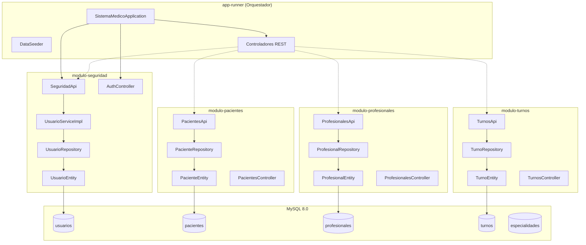

# Arquitectura Modular

## 1. Visión General

El backend sigue una **arquitectura monolito modular**, donde el dominio se divide en módulos independientes que coexisten en una sola aplicación desplegada. Cada módulo encapsula sus propias entidades, repositorios, servicios y controladores.

## 2. Diagrama de Módulos



## 3. Responsabilidades por Módulo

### modulo-seguridad
- **Entidades:** `UsuarioEntity`
- **Repositorios:** `UsuarioRepository`
- **Servicios:** `UsuarioServiceImpl` (implementa `SeguridadApi`)
- **Controladores:** `AuthController` (`/api/auth/*`), `AdministradoresController` (`/api/administradores`)
- **DTOs:** `LoginRequest`, `UsuarioRegistroRequest`, `UsuarioResponse`, `AuthResponse`, `Rol` (enum)
- **Funcionalidades:** Login, logout, registro de usuarios, asignación de roles, obtención de usuario autenticado

### modulo-pacientes
- **Entidades:** `PacienteEntity`
- **Repositorios:** `PacienteRepository`
- **API:** `PacientesApi`
- **Controladores:** `PacientesController` (`/api/pacientes/*`)
- **DTOs:** `PacienteRequest`, `PacienteResponse`
- **Funcionalidades:** Registro público de pacientes, listado y consulta de pacientes

### modulo-profesionales
- **Entidades:** `ProfesionalEntity`, `EspecialidadEntity`
- **Repositorios:** `ProfesionalRepository`
- **API:** `ProfesionalesApi`
- **Controladores:** `ProfesionalesController` (`/api/medicos`, `/api/profesionales`, `/api/especialidades`)
- **DTOs:** `ProfesionalRequest`, `ProfesionalResponse`, `EspecialidadResponse`
- **Funcionalidades:** Crear médicos (solo ADMIN), listar profesionales, listar especialidades

### modulo-turnos
- **Entidades:** `TurnoEntity`
- **Repositorios:** `TurnoRepository`
- **API:** `TurnosApi`
- **Controladores:** `TurnosController` (`/api/turnos/*`)
- **DTOs:** `TurnoRequest`, `TurnoResponse`, `EstadoTurno` (enum)
- **Funcionalidades:** Listar turnos, crear turnos, obtener turno por ID, cancelar turnos, listar por paciente

## 4. Patrón de Capas por Módulo

Cada módulo sigue una estructura de capas consistente:

```
modulo-xxx/
├── internal/
│   ├── entity/       → Entidades JPA (tablas de BD)
│   ├── repository/   → Interfaces Spring Data JPA
│   └── service/      → Lógica de negocio
├── dto/              → Objetos de transferencia (request/response)
├── mapper/           → Mapeadores Entity ↔ DTO (MapStruct)
└── api/              → Interfaces de servicio expuestas
```

## 5. Referencias de Arquitectura

- **Monolito Modular:** Patrón descrito en "Monolith First" de Martin Fowler
- **Domain-Driven Design (DDD):** Separación por dominio (seguridad, pacientes, profesionales, turnos)
- **Capas Hexagonales Simplificadas:** Cada módulo expone una API interna y oculta su implementación
- **BFF (Backend for Frontend):** El backend expone endpoints optimizados para el consumo del frontend React

---
